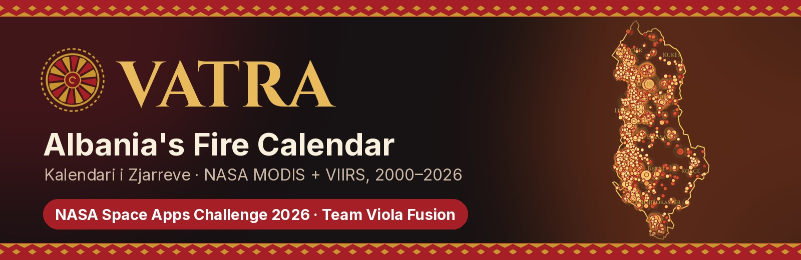

<p align="center">
  
</p>

<p align="center">
  <a href="https://doi.org/10.5281/zenodo.24231571"></a>
  <a href="https://doi.org/10.5281/zenodo.24231762"></a>
  <a href="https://doi.org/10.5281/zenodo.24232403"></a>
</p>

<h3 align="center">
  <a href="https://vatra-albania.streamlit.app">🔥 Open the app</a> &nbsp;·&nbsp;
  <a href="https://youtu.be/OU0LoOLec1c">🎬 Watch the 30-second demo</a> &nbsp;·&nbsp;
  <a href="https://doi.org/10.5281/zenodo.24232403">📄 Technical report</a>
</h3>

# VATRA: Albania's Fire Calendar · Kalendari i Zjarreve

A web app for the **NASA Space Apps Challenge 2026**, challenge **"Harmonization of MODIS and VIIRS Hot Spots"**.
Team **Viola Fusion** (Viola Zeneli, solo, Universal Event) · ORCID [0009-0000-2815-6398](https://orcid.org/0009-0000-2815-6398).

*Vatra* means "the hearth" in Albanian: fire as something to care for.

> **App asleep?** The free Streamlit app sleeps after some time without visitors. Click "Yes, get this app back up" and wait about 30–60 seconds.
> To run it on your own computer, see [Run it on your computer](#-run-it-on-your-computer).

## 🔥 What it does

NASA satellites have watched fires in Albania since 2000. The old sensor, **MODIS** (on Terra and Aqua, 1 km pixels),
is near the end of its life. The new one, **VIIRS** (on S-NPP, NOAA-20 and NOAA-21, 375 m pixels), sees much more
detail, so raw hotspot counts jump in 2012 even though the fires did not. VATRA joins both into **one record where
the satellite no longer matters**, and shows it as a burning activity calendar for any area and dates.

**Headline finding (from the real data):** raw satellite counts suggest fires rose **+194%** after 2012
(2012–2016 vs 2007–2011). That jump is the new satellite, not new fires: in VATRA's harmonized record the change is **−29%**.
Over 2003–2025 there is no clear trend (Mann–Kendall p = 0.43). The worst year was 2007, the worst month August 2012,
and the county with the most fire activity is Vlorë.

**Validation:** fit on 2012–2019, tested on 2020–2025 (72 months never used for fitting): Pearson r = 0.99,
Spearman ρ = 0.96, bias −11%. Against EFFIS burnt areas (yearly): Pearson r = 0.86, Spearman ρ = 0.94.

| Raw counts after 2012 | Harmonized change | Clean detections | Satellites | Fire events | Years |
|:---:|:---:|:---:|:---:|:---:|:---:|
| **+194%** | **−29%** | 105,051 | 5 | 2,774 | 2000–2026 |

## 🗺️ Pages

- **Home** – headline finding, "Albania now" (last 7 and 30 days vs normal), key numbers, a mini calendar, county shortcuts.
- **Calendar** – months × years heatmap (harmonized, raw MODIS or raw VIIRS); "vs normal" and intensity views;
  click a month for details; **Embroidery** view (the same data as Albanian cross-stitch) with SVG and A3 poster.
- **Map** – every detection (clustered, all satellites or only MODIS / only VIIRS), county and municipality borders, EFFIS burnt areas, heritage sites, parks;
  draw a box or polygon to set your own area.
- **Compare** – this month vs normal, two years side by side, trend, "What if MODIS turns off?".
- **Regions** – 12 county cards, then each county (history, nature, fire profile, with sources) and its municipalities.
- **Story** – 26 years of fire in short chapters with real numbers.
- **Heritage**, **How it works**, **Downloads** (CSV, PDF reports in English or Albanian, poster, activity sheet),
  **For Kids** (the game *Sky Twins* with a certificate), **About** (why I built VATRA, our traditions, credits, licences, AI use).
- **Viola** – a guide (bottom right) with prepared answers computed from the data. It is not a chatbot; for questions it does not know, it suggests the closest ones.

Every page works in **English and Albanian**, in **light and dark** mode, on laptops and phones.
Filters (area, dates, data type, options) stay the same when you change pages. The **Harmonized / Raw MODIS / Raw VIIRS** switch in the filter bar
changes the calendars (Home, Calendar, Regions), the Map dots and the two-year chart on Compare; normals, trends and "Albania now"
always use the harmonized record.

## ⚙️ Method in short

1. **Load** all FIRMS files (archive + near real time), keep archive data where it exists, remove duplicates,
   static sources (factories) and points outside Albania.
2. **Fire cell-days**: each ~1 km grid cell (0.01°) counts once per day per satellite.
3. **Harmonize**: `log(MODIS + 1) = a + b · log(VIIRS + 1)` on monthly cell-days, per VIIRS satellite and season
   (May–Oct / Nov–Apr). From 2012 the record is the **mean** of the calibrated VIIRS satellites, so it does not jump when a
   new satellite joins. Terra-only months (Nov 2000 – Jun 2002) are scaled to Terra + Aqua and marked "≈".
   Counties get a small adjustment shrunk towards the national fit and are scaled to add up to the national total.
   Every cell-day gets a weight, so any area (also a drawn one) is the sum of its weights.
4. **Validate** on years not used for fitting, and against EFFIS burnt areas.

Normals use 2003–2025 (median, P10, P90). Trend: Mann–Kendall + Sen's slope.
Full details: the **How it works** page and [`outputs/README.md`](outputs/README.md).

## 💻 Run it on your computer

You need **Python 3.12** (on a Mac: python.org → Downloads → macOS → "Python 3.12.10", macOS 64-bit universal2 installer).
Check it with `python3.12 --version`. Newer versions (3.13+) may not have all the packages yet.

### First time only

1. Open the `VATRA` folder in **VS Code** (File → Open Folder).
2. Open a terminal: **Terminal → New Terminal**.
3. Type these one by one:

```bash
python3.12 -m venv .venv               # makes a private Python just for VATRA (the .venv folder)
source .venv/bin/activate              # turns it on: the line now starts with (.venv)
pip install -r requirements-build.txt  # installs the packages (a few minutes)
python build.py                        # builds outputs/ from data/ (about 15 seconds)
streamlit run app.py                   # starts the app
```

4. The app opens in your browser at **http://localhost:8501**.
   To open it on your phone (same Wi-Fi), use the "Network URL" the terminal shows.
5. To stop the app: click in the terminal and press **Ctrl + C**.

In VS Code, also choose the right Python once: **Cmd + Shift + P → Python: Select Interpreter → 3.12 ('.venv')**.

### Every next time

Open the `VATRA` folder in VS Code, open a terminal, and type:

```bash
source .venv/bin/activate   # skip if the line already starts with (.venv)
streamlit run app.py
```

No need to install again. Run `python build.py` again only if the files in `data/` change.

### Latest days (optional key)

The data files end on 7 Nov 2026. For the newest days the app asks NASA FIRMS, which needs a free MAP_KEY:

- **On your computer:** copy `.env.example` to `.env` and write `FIRMS_MAP_KEY=your_key` in it.
- **Online (Streamlit Cloud):** app → Settings → Secrets → `FIRMS_MAP_KEY = "your_key"`.

Never upload the key: `.env` is in `.gitignore`. Without a key the app still works and says "latest days unavailable".

### If something goes wrong

- `command not found: python3.12` → install Python 3.12 (see above), then open a new terminal.
- `No module named streamlit` → the venv is off: run `source .venv/bin/activate` first.
- `outputs/ is missing` → run `python build.py` once.
- The page looks old after a change → stop with Ctrl + C, run `streamlit run app.py` again, refresh with Cmd + Shift + R.

## 📁 Folders

| Folder / file | What |
|---|---|
| `app.py` | the app entry (frame, navigation) |
| `build.py`, `config.py` | builds `outputs/` from `data/`; all settings in one place |
| `src/` | method (`load`, `clean`, `grid`, `harmonize`, `stats`, `events`, `effis`, `stories`) and app parts |
| `views/` | one file per page (named `views`, not `pages`, so Streamlit's old page system does not take over) |
| `content/` | all texts in English and Albanian, county facts and heritage sites, each with a source |
| `game/sky_twins.html` | the kids' game (plays only inside the app) |
| `data/` | the downloaded source data (see `data/README.md`) |
| `outputs/` | harmonized results (see `outputs/README.md`) |
| `assets/` | guide photos, fonts (Inter, Cinzel), icon |
| `docs/` | short technical report (PDF) and the README banner |

## 📦 Data produced by VATRA

`build.py` writes everything into `outputs/` (about 24 MB). These are the files to share and reuse (CC BY 4.0):

| File | What is inside |
|---|---|
| `monthly_harmonized.csv` | **Main table**: fire activity per month for Albania, the 12 counties and 61 municipalities (raw MODIS, raw VIIRS, harmonized, uncertainty, normal, status) |
| `celldays_harmonized.csv` | Every fire cell-day (≈1 km cell, one day, one satellite) with its harmonized weight |
| `fires_clean.csv` | Every satellite detection after cleaning |
| `events.csv` | Fire Events Catalogue (2,774 events: dates, place, size, intensity, nearest heritage site, EFFIS match) |
| `anomalies.csv`, `seasons.csv`, `trends.csv` | Unusual months, fire seasons and trends per area |
| `effis_comparison.csv` | Harmonized activity next to EFFIS burnt area, per year and month |
| `calibration.json`, `validation.json` | Fit parameters and validation numbers |

For uploading, `build.py` also copies exactly these files into `outputs/dataset_to_publish/` (kept on your computer only, not on GitHub, to avoid duplicates).
The `.parquet` and `.geojson` files are faster copies used by the app. Every column is explained in
[`outputs/README.md`](outputs/README.md). A short technical report is in [`docs/`](docs/VATRA_technical_report_v1.pdf).

## 📚 How to cite

All three parts are on Zenodo (community [VATRA – Albania's Fire Calendar](https://zenodo.org/communities/vatra)):

- **Software:** Zeneli, V. (2026). *VATRA: Albania's Fire Calendar* (v1.0). Zenodo. https://doi.org/10.5281/zenodo.24231571
- **Dataset:** Zeneli, V. (2026). *VATRA: harmonized MODIS–VIIRS active fire record for Albania, 2000–2026* (1.0). Zenodo. https://doi.org/10.5281/zenodo.24231762
- **Report:** Zeneli, V. (2026). *VATRA: harmonizing MODIS and VIIRS hotspots for Albania, 2000–2026 – Technical report*. Zenodo. https://doi.org/10.5281/zenodo.24232403

GitHub's "Cite this repository" button gives the software citation (from `CITATION.cff`). Please also cite the NASA FIRMS datasets listed below.

## ⚠️ Known limits

- Hotspots show heat seen by a satellite at pass time, not burnt area; small, short or cloud-covered fires can be missed.
- Harmonized values are MODIS-equivalent estimates with an uncertainty band. The last years fit a little lower (bias −11%), likely because the MODIS orbits are drifting.
- Latest days from the FIRMS API use an approximate weight. VATRA is not an official warning service.

## 🙏 Credits and licences

- **NASA FIRMS** active fire data: MODIS C6.1 and VIIRS 375 m (S-NPP, NOAA-20, NOAA-21), LANCE FIRMS, NASA ESDIS.
  Dataset DOIs: MODIS C6.1 NRT doi:10.5067/FIRMS/MODIS/MCD14DL.NRT.0061, MODIS archive MCD14ML doi:10.5067/FIRMS/MODIS/MCD14ML,
  VIIRS S-NPP doi:10.5067/FIRMS/VIIRS/VNP14IMGT_NRT.002, NOAA-20 doi:10.5067/FIRMS/VIIRS/VJ114IMGT_NRT.002,
  NOAA-21 doi:10.5067/VIIRS/VJ214IMG_NRT.002.
  Giglio, Schroeder & Justice (2016), doi:10.1016/j.rse.2016.02.054; Schroeder et al. (2014), doi:10.1016/j.rse.2013.12.008.
  NASA does not endorse this project.
- **EFFIS** burnt areas, © European Union, 1995–2026, Copernicus Emergency Management Service.
- **geoBoundaries** (CC BY 4.0) for the country border; **OCHA COD-AB** (CC BY-IGO) for counties and the 61 municipalities.
- Basemaps: Esri (Light Gray Canvas, World Imagery) with © OpenStreetMap contributors. Fonts: Inter and Cinzel (SIL OFL).
- **Code: MIT** (see `LICENSE`). **Derived data in `outputs/`: CC BY 4.0.** Source data keep their own terms.

**AI use:** Claude (Anthropic) helped with code, text and design. The guide photo of Viola is a real photo with
traditional clothing added using ChatGPT (marked "AI-edited" in the app). The "Listen" button uses the browser's own computer voice.

**Disclaimer:** VATRA is a research and education tool, not an official warning service.

Built for Albania, ready for any region: the country, files and settings live in `config.py`.
